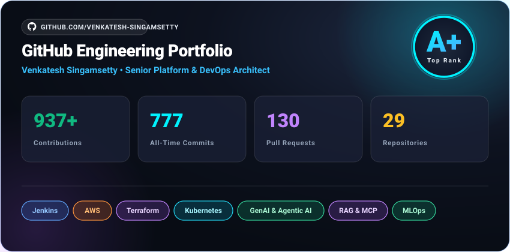

# Hi there, I'm Venkatesh Singamsetty 👋

[](https://www.linkedin.com/in/venkatesh-singamsetty-471687a3)
[](mailto:singamsetty.venkatesh7@gmail.com)
[](https://cricscore.venkateshsingamsetty.com)
[](https://github.com/venkatesh-singamsetty/cricscore/releases/tag/v4.16.0)

---

### 👨‍💻 About Me

Senior **Platform & DevOps Engineer** with **15+ years of experience** specializing in enterprise Jenkins platforms, scalable CI/CD pipelines, and cloud infrastructure in regulated financial environments.

- ⚡ Migrating **20,000+ repositories and Jenkins jobs** from GHES to GitHub Enterprise Cloud using custom Probot *(in progress)*.
- 🏗️ Managed and operated **600+ Jenkins controllers** on **Red Hat OpenShift and Kubernetes** using **Jenkins Configuration as Code (JCasC)** and **Argo CD**.
- ⚙️ Automated Jenkins setup and maintenance across Linux servers and VMs using **Ansible** and **Chef**.
- 📦 Provisioned **JFrog Artifactory SaaS** in a multi-region setup (AWS US-East and US-West) using **Terraform**.
- 💡 Built reusable shared libraries and developer tooling so teams can set up pipelines easily without repeating work.
- 📈 Implemented monitoring and alerts with **Datadog and CloudWatch**, helping teams optimize cloud usage and costs.
- 📚 Authored clear architecture guides, runbooks, and diagrams to help engineering teams adopt platform tools without friction.
- 🤖 **Side Project**: Built **CricScore**, a real-time cricket platform featuring autonomous multi-agent AI (MCP), pgvector RAG, and an MLOps win-prediction engine.
- 💬 Ask me about: **Enterprise Jenkins scaling, GitOps, Kubernetes governance, DevSecOps, Cloud Cost Optimization (FinOps), and Full-Stack Observability**.

---

### 🛠️ Tech Stack & Tooling

```
CI/CD & Jenkins      : Enterprise Jenkins (JCasC, Shared Libraries), Distributed Agents, Argo CD, GitHub Actions, Probot
Artifacts & SaaS     : JFrog Artifactory SaaS (US-East/West), Sonatype Nexus, Nginx Reverse Proxies
Cloud & IaC          : AWS, Terraform, Ansible, Chef
Containers/GitOps    : Kubernetes, Red Hat OpenShift, Argo CD, Docker, Helm
Security & DevSecOps : HashiCorp Vault, Cycode, JFrog Xray, Sonatype Nexus Lifecycle, CodeQL, OWASP ZAP, Trivy, GitLeaks, Syft SBOM
Observability & Ops  : Datadog, CloudWatch, ELK Stack, Distributed Tracing
FinOps & Governance  : Cloud Cost Optimization, Zero-Idle Architecture, AWS Budgets
Languages            : Groovy (Jenkins DSL), Python, Bash/Shell, Go, Node.js, TypeScript, SQL
AI & MLOps           : Model Context Protocol (MCP), LangGraph, pgvector, XGBoost, Scikit-learn, MLflow, DVC, AWS Lambda Containers
```

<p align="left">
  <br/>
  
</p>

---

### 🏏 Featured Open-Source Project

#### **[CricScore — Production Real-Time Multi-Cloud Cricket Platform](https://github.com/venkatesh-singamsetty/cricscore)**
> *Real-time cricket scoring platform built with serverless AWS and Aiven PostgreSQL, featuring autonomous multi-agent AI and live win prediction.*

- 🌐 **Live App:** [cricscore.venkateshsingamsetty.com](https://cricscore.venkateshsingamsetty.com) · [Architecture FAQ](https://github.com/venkatesh-singamsetty/cricscore/blob/main/docs/architecture_faq.md) · [Release v4.16.0](https://github.com/venkatesh-singamsetty/cricscore/releases/tag/v4.16.0)
- 🤖 **Multi-Agent AI (MCP):** Uses an in-memory Model Context Protocol server to coordinate 6 specialist tools for live match SQL queries, tournament rules search (pgvector), free weather reports (Open-Meteo), GitHub issue reporting, and match situation analysis.
- 🧠 **MLOps & Win Probability:** Trained on 786K+ deliveries tracked with DVC and MLflow; runs an XGBoost model verified with SHA-256 checksums from an S3 registry alongside a dynamic programming chase simulation for sub-100ms predictions.
- ⚡ **Real-Time Streaming:** Uses Amazon SNS and WebSocket API Gateway for instant live score broadcasts, with SQS ensuring safe database persistence.
- ☁️ **Multi-Cloud IaC:** 100% automated with Terraform across AWS and Aiven PostgreSQL, designed with a zero-idle footprint to run at minimal operational cost.
- 🛡️ **DevSecOps:** Automated CI/CD pipeline with GitLeaks, Checkov, Trivy, CodeQL, OWASP ZAP, and Playwright end-to-end tests.
- 🏆 **[👉 View Engineering Pull Requests](https://github.com/venkatesh-singamsetty/cricscore/pulls?q=is%3Apr+author%3Avenkatesh-singamsetty)** *(hides automated bot PRs)*

---

### 📊 GitHub Stats

<div align="center">
  
</div>

---

### 📜 Certifications

- **Jenkins Certified Administrator (CJA)**
- **Certified Kubernetes Administrator (CKA)**
- **AWS Certified Solutions Architect – Associate**
- **HashiCorp Certified Terraform Associate**
- **AWS Certified AI Practitioner**

---

<p align="center">
  <i>"Automate everything, verify continuously, and build for resilient scale."</i>
</p>
