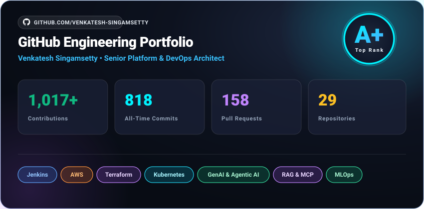

# Hi there, I'm Venkatesh Singamsetty 👋

[](https://www.linkedin.com/in/venkatesh-singamsetty-471687a3)
[](mailto:singamsetty.venkatesh7@gmail.com)

---

### 👨‍💻 About Me

Senior **Platform & DevOps Engineer** with **15+ years of experience** specializing in enterprise CI/CD platforms, Kubernetes/OpenShift operations, and cloud infrastructure in regulated financial environments.

- ⚡ Leading the migration of **20,000+ repositories and Jenkins jobs** from GitHub Enterprise Server (GHES) to GitHub Enterprise Cloud (GHEC) using custom Probot automation.
- 🏗️ Operated and scaled **600+ Jenkins controllers** on **Red Hat OpenShift & Kubernetes** using **Jenkins Configuration as Code (JCasC)** and **Argo CD**.
- ⚙️ Automated infrastructure provisioning and lifecycle management across Linux fleets using **Terraform**, **Ansible**, and **Chef**.
- 📦 Architected and provisioned multi-region **JFrog Artifactory SaaS** (AWS US-East & US-West) with **Terraform**.
- 💡 Built standardized declarative CI/CD shared libraries, self-service developer tooling, and guardrails to accelerate safe enterprise delivery.
- 📈 Designed observability, alerting, and FinOps guardrails with **Datadog** and **AWS CloudWatch** to optimize reliability and cloud spend.
- 💬 Ask me about: **Enterprise CI/CD & Jenkins at scale, GitOps, Kubernetes/OpenShift governance, DevSecOps, Cloud FinOps, and Observability**.

---

### 🛠️ Tech Stack & Tooling

```text
CI/CD & GitOps       : Enterprise Jenkins (JCasC, Shared Libraries), GitHub Actions, Argo CD, Probot
Cloud & IaC          : AWS, Terraform, Ansible, Chef
Containers & Platform: Kubernetes, Red Hat OpenShift, Docker, Helm
Artifacts & Registries: JFrog Artifactory SaaS (Multi-Region), Sonatype Nexus, Nginx
Security & DevSecOps : HashiCorp Vault, Cycode, JFrog Xray, Nexus Lifecycle, CodeQL, OWASP ZAP, Trivy, GitLeaks, Syft SBOM
Observability & FinOps: Datadog, AWS CloudWatch, X-Ray, ELK Stack, AWS Budgets
Languages            : Groovy (Jenkins DSL), Python, Bash/Shell, Go, TypeScript, Node.js, SQL
AI & MLOps           : Model Context Protocol (MCP), LangGraph, pgvector, XGBoost, MLflow, DVC
```

<p align="left">
  <br/>
  
</p>

---

### 🚀 Featured Open-Source Project

- **[CricScore](https://github.com/venkatesh-singamsetty/cricscore)** ([Live App](https://cricscore.venkateshsingamsetty.com)) — Real-time AWS Serverless & PostgreSQL (`pgvector`) cricket scoring and analytics platform with sub-second WebSockets, 4-agent MCP AI assistant, XGBoost + Markov DP win prediction, and immutable 2-env CI/CD running `dev` + `prod` for **~$1/month**.

---

### 📜 Certifications & Training

- **Generative AI & Agentic AI with Python** — Naresh IT
- **AWS Certified AI Practitioner**
- **AWS Certified Solutions Architect – Associate**
- **HashiCorp Certified Terraform Associate**
- **Jenkins Certified Administrator (CJA)**
- **Certified Kubernetes Administrator (CKA)**

---

### 📊 GitHub Stats

<div align="center">
  
</div>

---

<p align="center">
  <i>"Automate everything, verify continuously, and build for resilient scale."</i>
</p>
